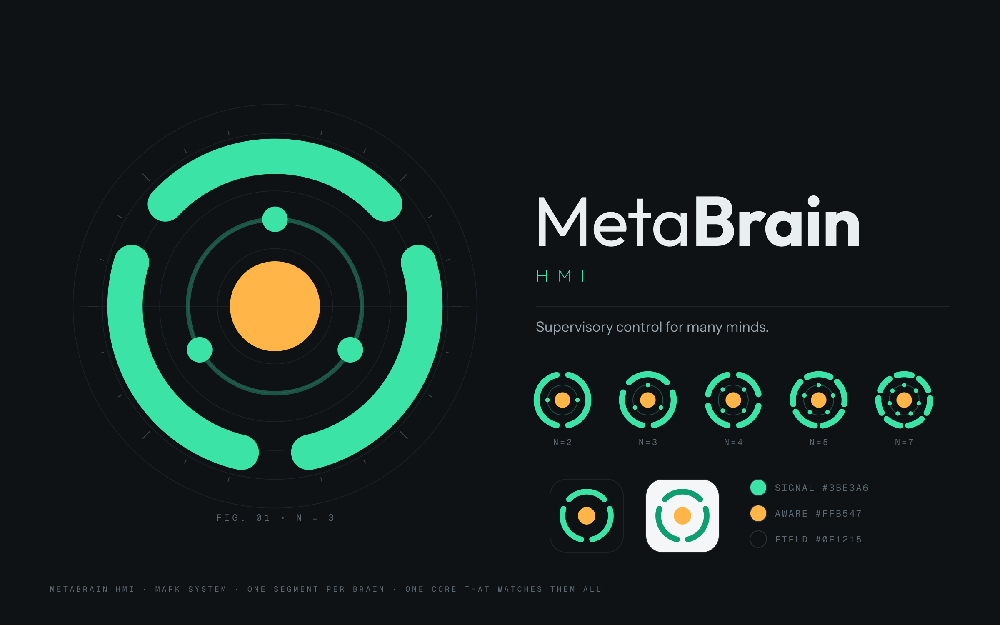
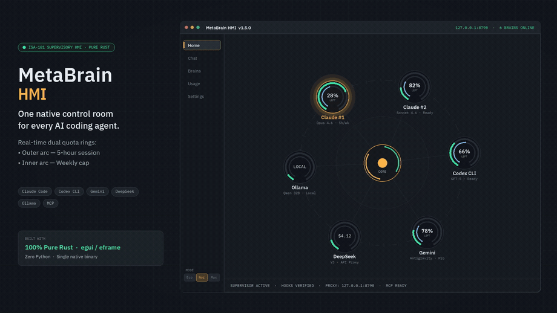

<p align="center">
  
</p>

<h1 align="center">MetaBrain HMI</h1>

<p align="center">
  <strong>Control supervisorio y orquestación multi-cerebro para agentes de código con IA — 100 % en Rust puro.</strong>
</p>

<p align="center">
  <a href="https://github.com/tebl22/metabrain-hmi/actions/workflows/rust.yml"></a>
  <a href="https://github.com/tebl22/metabrain-hmi/releases"></a>
  
  
  <a href="LICENSE"></a>
</p>

<p align="center">
  <a href="README.md">English</a> · <strong>Español</strong> · <a href="#probar-al-instante-sin-credenciales---demo">Probar <code>--demo</code></a> · <a href="SECURITY.md">Seguridad</a> · <a href="CHANGELOG.md">Changelog</a>
</p>

<p align="center">
  
</p>

MetaBrain corre localmente en tu equipo como una sola aplicación nativa de escritorio (`egui` / `eframe`) con supervisor en bandeja, proxy de medición de API, hooks de Claude Code, enrutador adaptativo consciente del costo, motor paralelo DAG, servidor MCP y un monitor minimalista de solo lectura para celular/LAN.

---

## Capacidades principales

- **Control supervisorio multi-cerebro (HMI ISA-101):** Mapa orbital en vivo de cuentas de Claude Code, ChatGPT (Codex CLI), Google (Antigravity / Gemini), DeepSeek, OpenRouter, Groq, OpenAI, Anthropic y Ollama local — con anillos de cuota en tiempo real (sesión de 5 h y semanal).
- **Failover automático y sucesión de cuentas:** Cambio anticipado de cuenta, bajada gradual por umbral de cuota, detección de tareas trabadas y traspasos estructurados de sesión sin gastar cuota extra.
- **Modos de operación y Piloto automático:** Cambia globalmente entre **Eco**, **Normal** y **Max** desde la barra lateral o Ajustes, y configura el **Piloto automático** por cerebro (`Off` / `Advise` / `Auto`).
- **Chat nativo y cambio dinámico de modelo:** Detección en vivo de intención al redactar (p. ej. `usa opus`, `/model sonnet`, `@codex` o `hazlo en paralelo`), carpetas de proyecto, aislamiento con worktrees de Git, diffs unificados y extracción de PDF a Markdown en **Rust puro** (cero dependencia de Python).
- **Orquestación paralela DAG:** Descompone tareas complejas en grafos acíclicos de dependencias, ejecuta ramas en paralelo entre distintos cerebros, verifica automáticamente ramas de construcción y muestra las ramas como subchats y nodos orbitales.
- **Enrutador adaptativo con verificación:** Aprende tasas de éxito por proyecto y nivel usando verificaciones ejecutables (`cargo test`, `npm test`, `go test`, etc.) y escala solo cuando una comprobación falla.
- **Monitor minimalista de solo lectura para LAN:** Panel móvil opcional protegido con PIN (`--lan`) para vigilar cuotas, cola y alarmas desde el celular — estrictamente de solo lectura, sin `innerHTML` y con CSP estricto.
- **Servidor MCP integrado:** Expone los cerebros, la cola y las tareas de MetaBrain a clientes MCP externos mediante `metabrain-hook mcp`.

---

## Seguridad y fiabilidad

- **Solo `localhost` por defecto:** La API HTTP y el proxy escuchan en `127.0.0.1` salvo que pases `--lan` explícitamente.
- **Defensa contra DNS Rebinding y CSRF:** Validación estricta de `Host`, `Origin`, `Referer` y `Sec-Fetch-Site`.
- **Mínimo privilegio en agentes CLI:** Las tareas de construcción corren con sandbox por defecto (`workspace-write` / `--mode auto`) y el modo `plan` impone solo lectura en todos los agentes; omitir sandboxes (`allow_unsafe_exec`) exige activación explícita en Ajustes.
- **Hooks y proxy endurecidos:** Política de solo lectura endurecida en hooks, `redirects(0)` y límite de 16 MiB en el proxy, listas blancas estrictas para `task_id` y rutas de proyecto, y confirmación con `Ctrl+Shift+A` / `Ctrl+Shift+D` para permisos.
- **Persistencia atómica y respaldo ante corrupción:** Escrituras atómicas con `sync_all` + renombre; si `metabrain.json` se corrompe en disco, se respalda como `.corrupt.<timestamp>` antes de regenerar valores por defecto.
- **Cero dependencia de Python:** La extracción de texto de PDFs corre de forma nativa en Rust (`flate2`) con límites contra bombas de descompresión.

Consulta [SECURITY.md](SECURITY.md) para el modelo de amenazas y el reporte de vulnerabilidades.

---

## Inicio rápido

### Probar al instante sin credenciales (`--demo`)

¿Quieres explorar el HMI, el mapa orbital de cerebros, los anillos de cuota, el orquestador paralelo y Ajustes sin configurar claves de API ni CLIs?

```bash
./target/release/MetaBrain serve --demo
```

`--demo` levanta MetaBrain en un sandbox temporal aislado con cuentas, cuotas y métricas simuladas — nunca toca tu configuración real en `~/.metabrain` o `%APPDATA%\MetaBrain`.

### Requisitos
- **SO:** Windows, macOS o Linux (x86_64 / arm64)
- [Toolchain de Rust](https://rustup.rs/) (estable, Edition 2021)
- Al menos un CLI o clave de API para modo real (Claude Code, Codex CLI, Antigravity CLI, DeepSeek, OpenAI, Anthropic u Ollama) — o ninguno con `--demo`

### Compilar desde fuente

```bash
cd rust
cargo build --release --locked
```

Esto genera dos binarios en `rust/target/release/`:
- `MetaBrain` (`MetaBrain.exe` en Windows) — HMI nativo de escritorio, bandeja y supervisor local
- `metabrain-hook` (`metabrain-hook.exe` en Windows) — binario de consola para hooks de Claude Code y comandos CLI/MCP

Ejecutar directamente:

```bash
./target/release/MetaBrain serve
```

Banderas opcionales:
- `--demo` — ejecuta en un sandbox aislado con cerebros, cuotas y tareas simuladas (cero credenciales)
- `--lan` — expone el monitor móvil de solo lectura con PIN en `0.0.0.0` (HTTP sin TLS; usar solo en redes de confianza)
- `--port <N>` — cambia el puerto de escucha (por defecto `8790`)
- `--no-tray` — ejecuta sin icono en la bandeja del sistema
- `--no-window` / `--web` — ejecuta solo el servidor sin abrir la ventana nativa de escritorio
- `--no-browser` — evita abrir pestaña del navegador al iniciar

### Instalar en macOS y Linux

```bash
./install.sh                   # compila desde fuente e instala en ~/.local/bin
./install.sh --with-hooks      # instala también los hooks de Claude Code
./install.sh --with-autostart  # activa inicio automático (LaunchAgent / XDG)
./install.sh --uninstall       # elimina binarios, hooks de MetaBrain e inicio automático
```

### Instalar en Windows

```powershell
powershell -ExecutionPolicy Bypass -File .\instalar_rust.ps1
```

El instalador usa staging atómico, verifica el PID real en `/api/health`, revierte automáticamente ante fallos, conserva `%APPDATA%\MetaBrain` y configura hooks + inicio automático.

### Gestión limpia de hooks

MetaBrain instala hooks en `~/.claude/settings.json` de forma no destructiva y puede eliminar **únicamente sus propias entradas** sin tocar tus hooks personalizados:

```bash
metabrain-hook hooks install [--dry-run]
metabrain-hook hooks uninstall [--dry-run]
```

También puedes instalar o desinstalar hooks desde **Settings → Diagnostics** en la aplicación de escritorio.

---

## Pruebas y verificación

```bash
cd rust
cargo fmt --check
cargo clippy --all-targets --locked -- -D warnings
cargo test --lib --locked -- --test-threads=1
cargo test --tests --locked
```

---

## Licencia

MIT — consulta [LICENSE](LICENSE).
