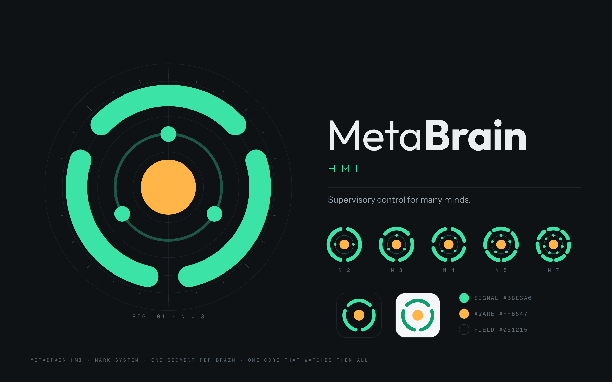
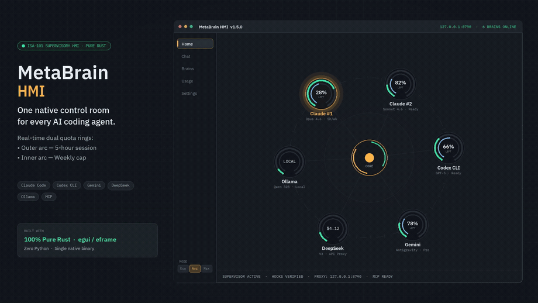

<p align="center">
  
</p>

<h1 align="center">MetaBrain HMI</h1>

<p align="center">
  <strong>Supervisory control and multi-brain orchestration for AI coding agents — built in 100% pure Rust.</strong>
</p>

<p align="center">
  <a href="https://github.com/tebl22/metabrain-hmi/actions/workflows/rust.yml"></a>
  <a href="https://github.com/tebl22/metabrain-hmi/releases"></a>
  
  
  <a href="LICENSE"></a>
</p>

<p align="center">
  <strong>English</strong> · <a href="README.es.md">Español</a> · <a href="#try-instantly-with-zero-credentials---demo">Try <code>--demo</code></a> · <a href="SECURITY.md">Security</a> · <a href="CHANGELOG.md">Changelog</a>
</p>

<p align="center">
  
</p>

MetaBrain runs locally on your machine as a single native desktop application (`egui` / `eframe`) with a tray supervisor, an API metering proxy, Claude Code hooks, an adaptive cost-aware router, a parallel DAG orchestrator, an MCP server, and a minimalist read-only LAN monitor for mobile devices.

---

## Key Capabilities

- **Multi-Brain Supervisory Control (ISA-101 HMI):** Live orbital map showing Claude Code accounts, ChatGPT (Codex CLI), Google (Antigravity / Gemini), DeepSeek, OpenRouter, Groq, OpenAI, Anthropic, and local Ollama instances — with real-time 5-hour session and weekly quota rings.
- **Automatic Failover & Account Succession:** Pre-emptive account switching, quota threshold step-down, stall detection, and structured session handoffs without spending extra quota.
- **Operation Modes & Autopilot:** Switch globally between **Eco**, **Normal**, and **Max** modes directly from the native sidebar or Settings, and configure per-brain **Autopilot** (`Off` / `Advise` / `Auto`).
- **Live Chat & Dynamic Model Switching:** Native chat with live intent detection (type e.g. `use opus`, `/model sonnet`, `@codex`, or `run in parallel` to dynamically adapt the composer), project folders, git worktree isolation, unified diffs, and pure-Rust PDF-to-Markdown attachment extraction (zero Python dependency).
- **Parallel DAG Orchestration:** Decompose complex tasks into acyclic dependency graphs, run independent branches concurrently across distinct brains/harnesses, verify build branches automatically, and inspect branches as organized subchats and orbital nodes.
- **Adaptive Router & Verification Loop:** Learns per-project success rates across model tiers using objective build/test checks (`cargo test`, `npm test`, `go test`, etc.) and escalates only when verification fails.
- **Minimalist Read-Only LAN Monitor:** Optional PIN-protected mobile dashboard (`--lan`) for checking live quotas, active queues, and alarms from your phone — strictly read-only, with zero `innerHTML` sinks and strict CSP headers.
- **Built-In MCP Server:** Expose MetaBrain's brains, queue, and tasks to external MCP clients via `metabrain-hook mcp`.

---

## Security & Reliability Model

- **Localhost by default:** The HTTP API and proxy bind to `127.0.0.1` unless `--lan` is explicitly passed.
- **DNS Rebinding & CSRF Protection:** Strict `Host`, `Origin`, `Referer`, and `Sec-Fetch-Site` validation on every request.
- **Least-Privilege CLI Execution:** CLI build tasks default to workspace sandboxes (`workspace-write` / `--mode auto`) and read-only `plan` modes; bypassing sandboxes (`allow_unsafe_exec`) requires explicit opt-in in Settings.
- **Hardened Hooks & Proxy:** Strict read-only shell command policy for hooks, `redirects(0)` and 16 MiB response caps in the proxy, strict allowlist validation for task IDs and project paths, and `Ctrl+Shift+A` / `Ctrl+Shift+D` confirmation shortcuts for permission prompts.
- **Atomic Persistence & Corrupt-Config Recovery:** Atomic temp-file + `sync_all` + rename writes; if `metabrain.json` is ever corrupted on disk, MetaBrain preserves a `.corrupt.<timestamp>` backup before regenerating defaults.
- **Zero Python Dependency:** PDF attachment extraction runs natively in pure Rust (`flate2`) with decompression size limits.

See [SECURITY.md](SECURITY.md) for vulnerability reporting and threat-model details.

---

## Quick Start

### Try Instantly with Zero Credentials (`--demo`)

Want to explore the HMI, orbital brain map, quota rings, parallel DAG monitor, and settings without configuring any API keys or CLIs?

```bash
./target/release/MetaBrain serve --demo
```

`--demo` launches MetaBrain against an isolated temporary sandbox preloaded with realistic simulated accounts, quotas, and metrics — your real `~/.metabrain` / `%APPDATA%\MetaBrain` config is never touched.

### Prerequisites
- **OS:** Windows, macOS, or Linux (x86_64 / arm64)
- [Rust toolchain](https://rustup.rs/) (stable, Edition 2021)
- At least one AI CLI or API key for live mode (e.g., Claude Code, Codex CLI, Antigravity CLI, DeepSeek, OpenAI, Anthropic, or Ollama) — or none for `--demo`

### Build & Run from Source

```bash
cd rust
cargo build --release --locked
```

This produces two binaries in `rust/target/release/`:
- `MetaBrain` (`MetaBrain.exe` on Windows) — native desktop HMI, system tray, and local supervisor
- `metabrain-hook` (`metabrain-hook.exe` on Windows) — console companion for Claude Code hooks and CLI/MCP commands

Run directly:

```bash
./target/release/MetaBrain serve
```

Optional flags:
- `--demo` — run in an isolated sandbox with simulated brains, quotas, and tasks (zero credentials required)
- `--lan` — bind the read-only PIN-protected mobile monitor to `0.0.0.0` (HTTP without TLS; use only on trusted local networks)
- `--port <N>` — override the listening port (default `8790`)
- `--no-tray` — run without the system tray icon
- `--no-window` / `--web` — run headless (server only, without opening the native desktop window)
- `--no-browser` — do not automatically open a browser tab on startup

### Install on macOS & Linux

```bash
./install.sh                   # build from source and install into ~/.local/bin
./install.sh --with-hooks      # also install Claude Code hooks
./install.sh --with-autostart  # also enable login autostart (LaunchAgent / XDG)
./install.sh --uninstall       # cleanly remove binaries, MetaBrain hooks, and autostart
```

### Install on Windows

```powershell
powershell -ExecutionPolicy Bypass -File .\instalar_rust.ps1
```

The installer uses atomic staging, verifies the new process PID on `/api/health`, automatically rolls back on failure, preserves your `%APPDATA%\MetaBrain` data, and installs Claude Code hooks + Windows autostart.

### Clean Hook Management

MetaBrain installs hooks into `~/.claude/settings.json` non-destructively and can cleanly remove **only its own entries** without touching your custom hooks:

```bash
metabrain-hook hooks install [--dry-run]
metabrain-hook hooks uninstall [--dry-run]
```

You can also install or uninstall hooks directly from **Settings → Diagnostics** in the desktop app.

---

## Running Tests & Quality Checks

```bash
cd rust
cargo fmt --check
cargo clippy --all-targets --locked -- -D warnings
cargo test --lib --locked -- --test-threads=1
cargo test --tests --locked
```

---

## Configuration

User configuration lives in `%APPDATA%\MetaBrain\metabrain.json` (Windows) or `~/.metabrain/metabrain.json` (Linux/macOS). See [examples/metabrain.example.json](examples/metabrain.example.json) for a starter template. API keys are read from OS environment variables (`DEEPSEEK_API_KEY`, `ANTHROPIC_API_KEY`, `OPENAI_API_KEY`, `GEMINI_API_KEY`, etc.) and never stored in `metabrain.json`.

---

## License

MIT — see [LICENSE](LICENSE).
